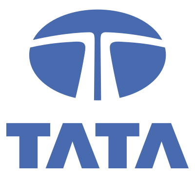

<div align="center">



# Task 2 — Predictive Model Plan

**Tata iQ Forage Simulation · Geldium Delinquency Prediction**


</div>

> **Disclaimer:** Part of the Tata iQ *Forage* educational simulation. The Tata name and logo are
> the property of Tata Sons Pvt. Ltd., used here solely to identify the simulation scenario.

## Contents

| File | Description |
|---|---|
| `Task_2_ModelPlan_Template.docx` | Official template supplied for Task 2 (preserved, never modified) |
| `Task_2_ModelPlan_Completed.docx` | Completed official template — 1. Model Logic (GenAI-generated) · 2. Justification for Model Choice · 3. Evaluation Strategy (includes executed baseline Table 1) |
| `Task_2_ModelPlan_Completed.pdf` | PDF version |
| `task2_model_plan.py` | Reproducible script: runs the baseline sanity check **and** regenerates the completed DOCX from the template |
| `baseline_check_results.json` | Machine-verified cross-validation results |

## What the plan contains

1. **Model Logic** — step-by-step pipeline (data contract → cleaning log → leakage-safe folds →
   imputation/encoding inside CV → class-weighted logistic regression champion + gradient-boosting
   challenger → cost-based threshold → fairness audit → monitoring), with pseudo-code and a
   scikit-learn snippet.
2. **Justification** — why regularised logistic regression is primary for Geldium (transparency,
   adverse-action reason codes, small-sample stability, regulatory fit) and why neural networks were
   rejected; includes the honest caveat that model choice is provisional while the data carries no
   proven signal.
3. **Evaluation Strategy** — PR-AUC as primary metric against the 0.16 no-skill floor, ROC-AUC,
   recall/precision at a cost-based threshold, lift/gains, Brier + calibration; fairness auditing
   across Age, Employment_Status and Location (incl. with/without Location); ethics (human-in-the-loop,
   reason codes, data minimisation, model card, drift monitoring) and an explicit **go/no-go gate**.

## Executed baseline sanity check (5×3 repeated stratified CV, cleaned Task 1 data)

| Model | PR-AUC | ROC-AUC | Brier ↓ |
|---|---|---|---|
| Dummy (stratified) | 0.164 ± 0.011 | 0.492 ± 0.043 | 0.253 |
| Logistic Regression (balanced) | 0.169 ± 0.037 | 0.445 ± 0.052 | 0.259 |
| HistGradientBoosting | 0.150 ± 0.020 | 0.405 ± 0.048 | 0.167 |
| **No-skill floor (base rate)** | **0.160** | **0.500** | — |

**Conclusion:** every candidate sits at the no-skill floor — measured confirmation of the Task 1
finding that the delivered dataset carries no usable delinquency signal. The plan therefore gates
deployment: fix the data pipeline before (not after) increasing model complexity.

## Reproduce

```bash
cd Task_2_ModelPlan
pip install pandas numpy scikit-learn openpyxl python-docx docx2pdf
python task2_model_plan.py     # re-runs CV and rebuilds the completed DOCX
```

Inputs (`Task_2_ModelPlan_Template.docx`, bundled in this folder, and
`../Task_1_EDA/Geldium_EDA_Outputs/Geldium_Cleaned_Dataset.xlsx`) are read-only; the official
template is never modified.
